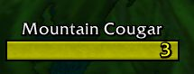
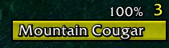
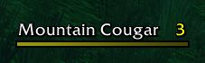
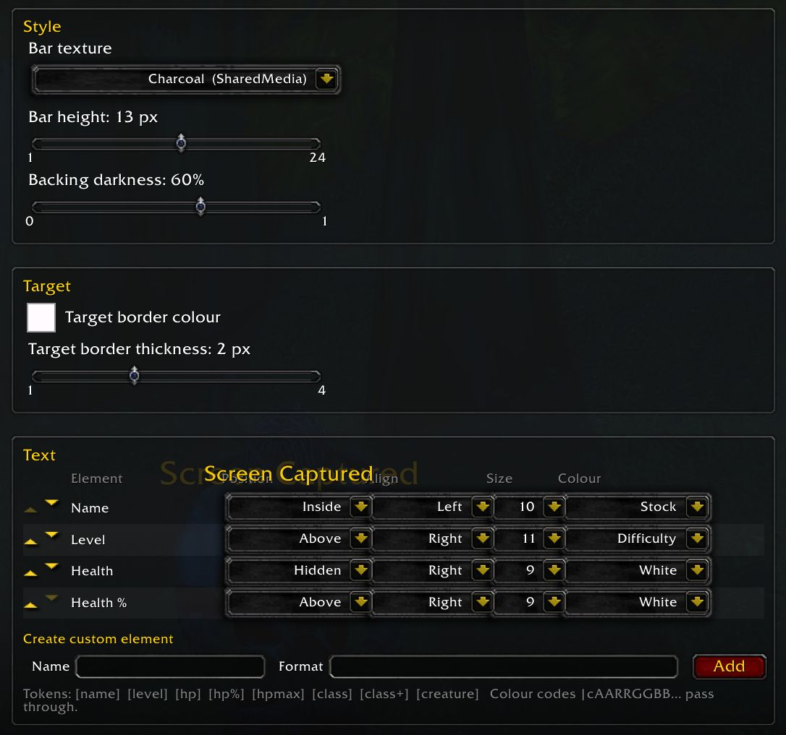

# Velocity Plate Style

Restyles **Blizzard's own nameplates** - flat bar, crisp 1px outline, level number inside the bar,
a clear target border - and does nothing else. Which plates appear, how far away, how big, how they
stack: all of that stays with the game's own Options > Nameplates.

**Classic Era / Hardcore and WoW Forever**, from one codebase.

## What it changes

- **The bar**: Blizzard's rounded bar art is replaced with a flat fill, a 1px black outline and a dark
  backing so the bar edge and the missing health stay readable. Any height from 1 to 24 px.
- **Text elements**: every piece of text on the plate - Name, Level, Health, Health % and any custom
  element you add - has the same controls: **position** (above / below / inside / left of bar / right of
  bar / hidden), **alignment**, **size** and **colour**. Elements sharing a position stack in the order
  you put them in; long names truncate with `...` instead of running into the level.
- **Custom elements**: give it a name and a format string - `[name] [level] [hp] [hp%] [hpmax] [class]
  [class+] [creature]` plus colour codes - and it joins the grid like the built-ins.
- **Level** is always shown and always difficulty-coloured (grey / green / yellow / orange / red, `??` for
  skull): this is a Hardcore addon first.
- **Target border** in a colour and thickness of your choice; Blizzard's own target highlight is
  switched off while it is on.
- **Bar texture**: Flat, Soft, or Blizzard's own. If another addon has loaded LibSharedMedia, its
  statusbar textures are offered too (not required, not bundled).

| | |
|---|---|
|  |  |
|  | |

## What it never does

- Never shows, hides, moves or resizes a plate. Never touches a CVar on its own. Nothing runs on a
  timer; it reacts to plates appearing, your target changing and your settings changing.
- Leaves Questie icons, raid markers, cast bars and auras exactly where they are - they draw on top.
  Plates in Blizzard's "show only names" mode (friendly units) are left completely stock.
- Stands down, with one chat line, if a plate-replacement addon (Threat Plates, Plater, Kui, NeatPlates,
  Platynator, ElvUI nameplates...) is running.

## Options

`/vps` opens the page (Options > AddOns > Velocity Plate Style). `/vps status` prints the client, style and
plate count; `/vps reset` restores defaults. Settings are account-wide.

## Roadmap

Text controls (name / level / health text font, size, outline), a visual texture picker, elite / rare /
boss representation modes, a mirror of the game's own nameplate settings, and an aggro cue. See
`SPECS/SPEC-VelocityPlateStyle.md`.

## Licence

MIT.